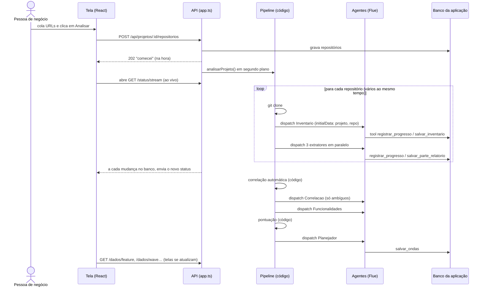

# 2. Do repositório à tela: o que acontece quando alguém clica em "Analisar"

Este guia segue um clique do começo ao fim. A ideia central: **a tela nunca espera um agente terminar**. Ela pede, recebe "ok, comecei" na hora, e depois acompanha o progresso por um canal ao vivo.

## O caminho completo



## Passo a passo

### 1. O clique

A tela `TelaPortfolio.tsx` envia as URLs:

```ts
await fetch(`/api/projetos/${projetoId}/repositorios`, { method: 'POST', body: JSON.stringify({ repositorios }) });
```

### 2. A API responde na hora e começa em segundo plano

Em `app.ts`:

```ts
void analisarProjeto(projetoId);          // não espera
return c.json({ ok: true }, 202);         // 202 = "aceito, vou processar"
```

> Em produção, troque o `void analisarProjeto(...)` por uma fila ou orquestrador durável (veja o guia 3). Assim, uma reinicialização do servidor não perde a análise no meio.

### 3. O "maestro" é código, não IA

`pipeline/analisar-projeto.ts` faz sempre a mesma sequência. Ele usa a função `rodarAgente`, que tem três linhas importantes:

```ts
const handle   = init(agente, { id });
const recibo   = await handle.dispatch({ message: mensagem, initialData: ctx });
const resposta = await handle.read(recibo);
```

Antes e depois, ela grava na tabela `progresso` (`rodando`, `concluido` ou `erro`).

### 4. Os agentes trabalham e avisam o progresso

Dentro de cada agente, duas tools fazem a ponte com a tela:

- `registrar_progresso`: chamada em marcos ("li 120 de 214 programas"). Grava percentual e mensagem.
- `salvar_*`: grava o resultado validado. É o que alimenta as telas de Conexões, Funcionalidades e Plano.

### 5. A tela acompanha ao vivo

`useStatusDaAnalise.ts` abre um `EventSource` para `/status/stream`. O servidor lê a tabela `progresso` a cada 2 segundos e só envia quando algo mudou. A função `resumirStatus` transforma as linhas no que a tela desenha:

| Na tela (protótipo) | Vem de |
| --- | --- |
| Barra "Análise" de cada aplicação | `status.aplicacoes[].percentual` e `.passo` |
| Painel "Em andamento" | `status.agentesAtivos[]` (agente, repositório, mensagem) |
| Etapas da análise | `status.etapas[]` |
| Classificação Moderna/Legada | `GET /dados/application` |
| Matriz de Conexões e Pendências | `GET /dados/connection` e `/dados/external` |
| Lista de Funcionalidades | `GET /dados/feature` |
| Ondas do Plano | `GET /dados/wave` |

### 6. O chat é outro canal

O painel do assistente **não** usa a tabela de progresso. Ele conversa direto com o agente `Assistente`, pelo hook oficial do Flue:

```ts
const agente = useFlueAgent({ url: `/agents/assistente/${projetoId}--${usuario}` });
await agente.sendMessage('Dá para trazer Consulta de fatura para a onda 1?');
```

As respostas chegam em partes:

- `text`: a resposta escrita;
- `dynamic-tool`: o agente está usando uma tool, e a tela mostra "Simulando o plano…";
- `data-simulacao`: o resultado da simulação, enviado pelo agente com `useDataWriter('simulacao')`. A tela desenha um cartão com as ondas, o que fica desligável e as tabelas divididas.

### 7. Decisões do usuário voltam para a análise

Quando a pessoa clica "Manter como está" em Pendências, ou confirma no chat, a tool `registrar_decisao` grava a decisão e chama `pipeline/reprocessar.ts`. Ele recalcula **só o que depende da decisão** (pontuação e plano) e não refaz a extração.

## Dois canais, por quê?

| | Progresso da análise | Chat |
| --- | --- | --- |
| Quem fala | Vários agentes, sem ninguém olhando | Uma pessoa e o assistente |
| Duração | Minutos a horas | Segundos |
| Como chega à tela | Tabela `progresso` + SSE | `useFlueAgent` (stream do próprio Flue) |
| Por que assim | A tela precisa de um resumo de dezenas de agentes, não da conversa de cada um | A tela precisa da conversa completa, mensagem a mensagem |
